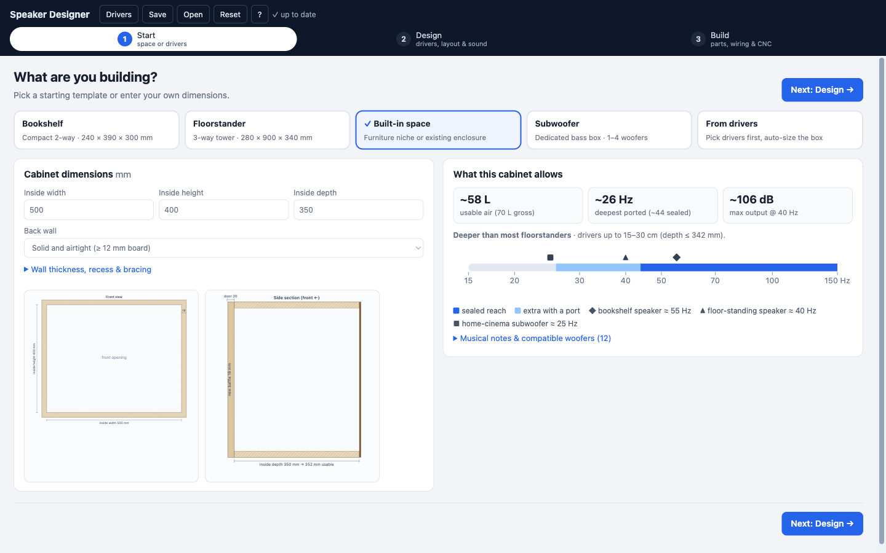
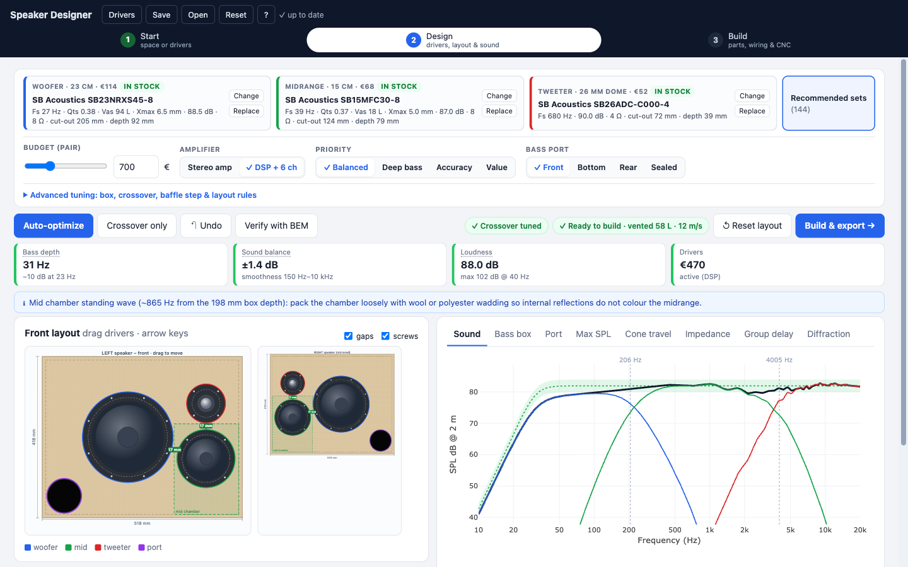
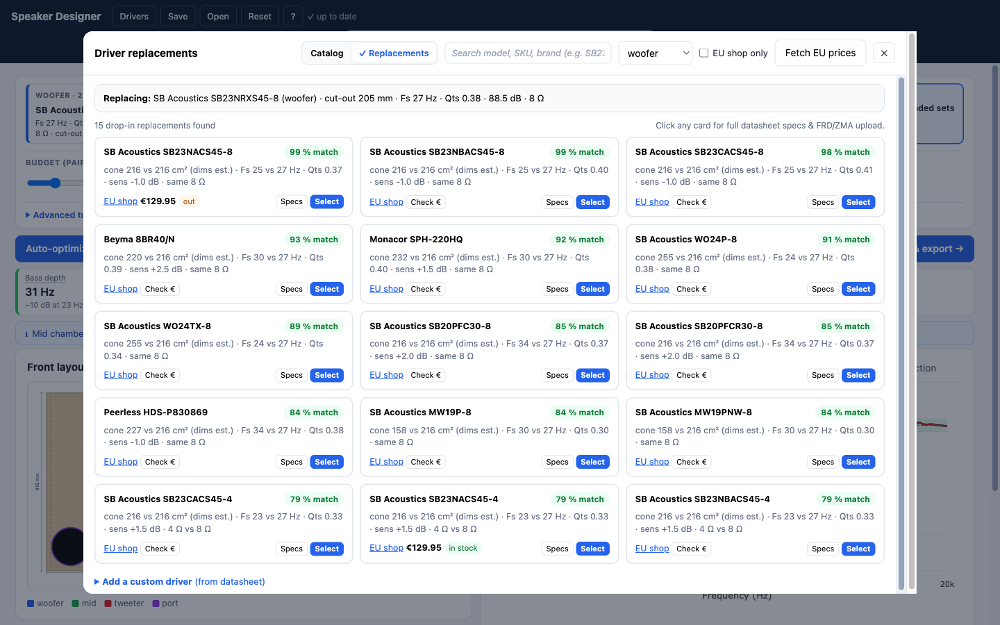
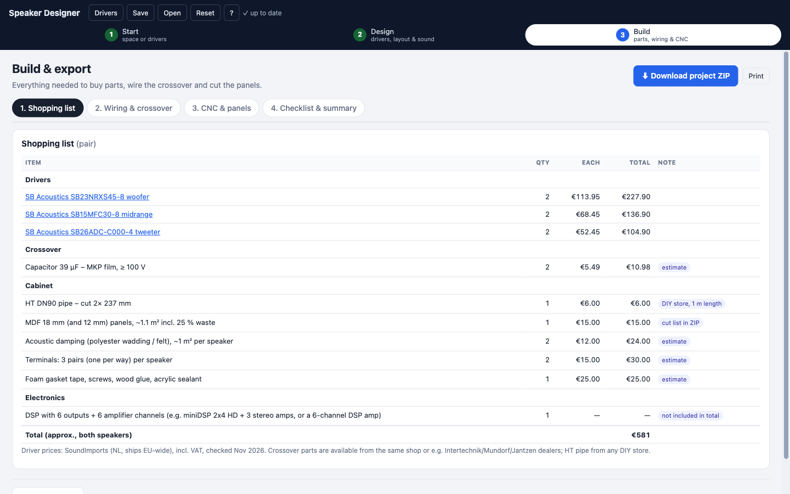

# Speaker Designer

Web application (FastAPI + Poetry + Plotly + vanilla JS) for designing 2-way, 3-way, and subwoofer enclosures using real European-available drivers, metric units (`mm`, `L`, `Hz`, `dB`, `€`), and CNC-ready manufacturing outputs.

## Quick Start

```bash
docker compose up -d --build          # open http://localhost:8000
docker compose exec speaker-calc pytest -q
```

Or run a published image directly from Docker Hub (tagged `YYYY.MM.DD.HHMM` and `latest`):

```bash
docker run --rm -p 8000:8000 valentas/speaker-designer:latest
```

---

## How to Use (3 Steps)

### 1. Start — Choose a Preset, Space, or Drivers
Pick a template (**Bookshelf**, **Floorstander**, **Built-in space**, **Subwoofer**, or **From drivers**) and check usable volume, deepest bass reach, and compatible drivers at a glance.



### 2. Design — Drivers, Layout & Sound
- **Active drivers bar:** inspect `Fs`, `Qts`, `Vas`, `Xmax`, sensitivity, impedance, cut-out, depth, EU price, and stock; click any card for full datasheet specs & `FRD`/`ZMA` upload, or click **Change** / **Replace** / **Recommended sets**.
- **Live tuning:** drag drivers/ports on the front baffle (or nudge with arrow keys); crossover points, levels, and polarity tune automatically, while **Auto-optimize** tunes layout + port + crossover together and **Verify with BEM** runs a full 3D boundary-element check.



### 3. Catalog & Drop-in Replacements
Browse **1,312 drivers** (`driver-base`, CC BY 4.0) with **547+** matched to SoundImports (NL) product links, check live EUR prices & stock on demand, or rank mechanical + acoustic drop-in replacements when a part is out of stock.



### 4. Build & Export
Four focused tabs: **Shopping list** (pair BOM with links and totals), **Wiring & crossover** (schematic, component ratings, solder/DSP guide), **CNC & panels** (layered DXF, 1:1 SVG templates, cut list CSV), and **Checklist & summary** (3D damping view, `ngspice` / `BEM` engine checks).



---

## Syncing Drivers & EU Prices

- **In the UI:** open **Drivers → Fetch EU prices** to refresh live EUR prices & stock from SoundImports JSON-LD / Audiophonics microdata (cached in `userdata/price_cache.json`), or click **Check €** on any individual driver card.
- **Via CLI (or inside Docker):**
  ```bash
  python scripts/sync_drivers.py             # update app/data/drivers.json from driver-base + SoundImports sitemap
  python scripts/sync_drivers.py --prices    # also refresh live EUR prices & stock for curated drivers
  ```
- **GitHub CI/CD (`.github/workflows/ci-release.yml`):** automatically syncs `app/data/drivers.json`, runs `mypy` + `pytest` inside the Poetry Docker image, publishes `valentas/speaker-designer:<YYYY.MM.DD.HHMM>` + `:latest` to Docker Hub (requires `DOCKERHUB_USERNAME` and `DOCKERHUB_TOKEN` repo secrets), and attaches `drivers.json` to the GitHub Release.

---

## Local Development (Poetry)

```bash
python3.12 -m venv .venv
.venv/bin/pip install poetry==2.5.1
.venv/bin/poetry install
.venv/bin/pytest -q
```

## Public Hosting (`READ_ONLY=1`)

```bash
READ_ONLY=1 docker compose up -d
```

- Projects stay in the visitor's browser (`localStorage` + JSON Save/Open); no user data is stored on the server.
- `READ_ONLY=1` disables mutating driver/price-batch/measurement endpoints for shared public instances.

## Physics & Verification Engines

| Engine | Licence | Purpose |
|---|---|---|
| **Internal acoustic solver** | MIT | T/S enclosure alignments (sealed `Qtc`, `QB3`, numerical vented sweep), Helmholtz ports, first-order edge diffraction, passive/active crossovers, complex summation |
| **bempp-cl** (`app/design/bem.py`) | MIT | On-demand 3D Burton-Miller BEM cabinet verification up to 1.2 kHz (1 job at a time per server) |
| **ngspice** (`/api/spice`) | BSD | Passive crossover circuit cross-check & downloadable SPICE netlist |
| **driver-base** (`app/data/drivers.json`) | CC BY 4.0 | Normalized manufacturer T/S & physical parameters |

> **Limitations:** Simulations are small-signal and anechoic (in-room bass will be stronger). Driver frame dimensions flagged *"Estimated — verify before CNC"* must be checked against the manufacturer drawing before cutting.

## Licence

MIT — see [LICENSE](LICENSE). Bundled `driver-base` catalog data in `app/data/drivers.json` is licensed under CC BY 4.0.
